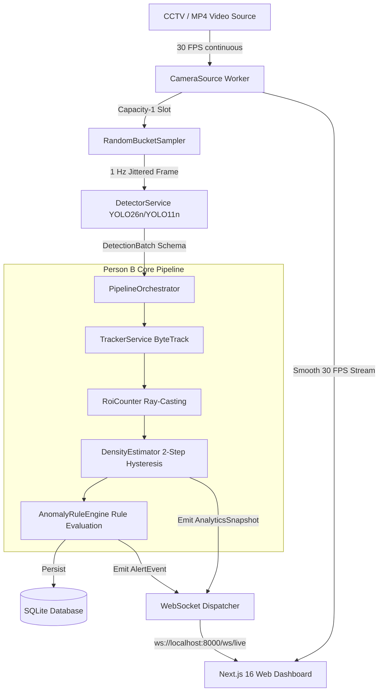

# Metro Safety AI — System Architecture & Data Flow

## 1. System Overview

**Metro Safety AI** is an edge-native computer vision and crowd safety analytics platform designed for metro station concourses and platform edges. It runs locally on an **NVIDIA GeForce RTX 5060 Laptop GPU (8 GB GDDR7)** under Windows.

The platform is designed around a **Modular Monolith Architecture** with strict decoupled ownership between:
- **Person A (Vision & Sampling)**: Video decode, 1 Hz bucketed randomized sampling, single-model YOLO detector, and Next.js operator dashboard.
- **Person B (Tracking, Analytics, Rules & Storage)**: Trajectory association via ByteTrack, Point-in-Polygon ROI counting, temporal hysteresis crowd density evaluation, safety anomaly rule engine, SQLite state persistence, and WebSocket push dispatcher.

---

## 2. Decoupled Contract Schemas

To guarantee zero regression between Person A and Person B, all communication crosses strict Pydantic v2 schemas:

1. **`DetectionBatch` (Person A $\to$ Person B):**
   - Transports normalized bounding boxes `[x1, y1, x2, y2]` in range `[0.0, 1.0]`.
   - Includes precise metadata: `camera_id`, `captured_at`, `sample_bucket_start`, `sample_offset_ms`, and `inference_ms`.
   - **Contract Rule:** Person B never calls PyTorch or reads raw frame tensors.

2. **`AnalyticsSnapshot` (Person B $\to$ UI/API):**
   - Emits instantaneous passenger counts, active track count, per-ROI counts, categorical crowd density (`LOW`, `MEDIUM`, `HIGH`) with smoothed scores, and end-to-end latency metrics (`pipeline_ms`, `sample_age_ms`).

3. **`AlertEvent` (Person B $\to$ UI/API):**
   - Emits safety incidents (`platform_intrusion`, `loitering`, `crowd_density`) with severity (`warning` or `critical`), target track IDs, and structured evidence.
   - **De-duplication Policy:** Ongoing sustained violations update the existing `event_id` rather than spamming duplicate alerts.

---

## 3. Sampling Policy & Latency Budget

Rather than performing continuous 30 FPS inference on all cameras (which would saturate the 8 GB VRAM and 70W power envelope of the laptop GPU), the system employs **1 Hz Per-Bucket Randomized Sampling**:
- Each 1.0s time window has an offset chosen uniformly at random: $t_{\text{sample}} \in [0.20, 0.80] \text{ s}$.
- Video decode runs asynchronously at 30 FPS, keeping the newest decoded frame in a capacity-1 thread-safe slot.
- Detector takes **~15–18 ms** for inference.
- Tracking, counting, density, and rules take **<2 ms**.
- Total pipeline latency is **<25 ms**, leaving **>97% of the GPU duty cycle** idle for multi-feed expansion or power efficiency.

---

## 4. Hardware Calibration (RTX 5060 Laptop GPU)

- **Compute Architecture:** NVIDIA Blackwell (sm_120 / sm_100).
- **VRAM:** 8,151 MiB GDDR7.
- **Power Envelope:** 70W TGP.
- **Precision:** FP16 half-precision inference baseline at 640x640 resolution.
- **Training Budget:** Batch size 8 starting point, dropping to 4 or 2 if concurrent applications consume VRAM.
